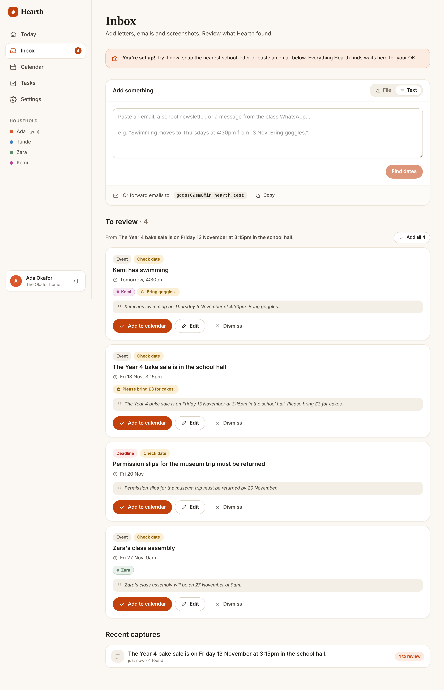

# Hearth

**The fridge door, finally organised.** Snap a school flyer, drop in a PDF, paste a message or forward an email. Hearth finds the dates, deadlines and to-dos, lets your household approve them in one tap, and puts them on the calendar you already use, with a nudge the night before.



- 📸 **Capture anything:** phone photo, PDF, screenshot paste, pasted text, or a forwarded email (attachments included)
- 🧠 **Reads it for you:** Claude extracts events, deadlines and tasks with times, places, who each one is for and what to prep. An offline parser handles text when no API key is set.
- ✅ **Humans approve:** nothing reaches the calendar until someone taps accept, and every item shows the quote it came from
- 👨‍👩‍👧 **Whole household:** invite partners and carers; add kids and grandparents as colour-coded people
- 📅 **Works with your calendar:** private ICS feeds (whole household or per person) for Google, Apple and Outlook
- ⏰ **Reminders:** morning digest and night-before prep emails
- 🔒 **Private by design:** no inbox access, a sender allow-list for forwarding, self-hostable, SQLite on your own volume

Docs: [Product requirements](docs/PRD.md) · [Design system](docs/DESIGN.md)

---

## Quick start (local)

```bash
npm install
cp .env.example .env.local   # add ANTHROPIC_API_KEY to read photos/PDFs
npm run dev                  # http://localhost:3000
```

Create an account, set up your household, then paste this into the Inbox:

> The Year 4 bake sale is on Friday 13 November at 3:15pm in the school hall. Please bring £3 for cakes.

## Deploy

Hearth is a single Node process with a SQLite database, so any host with a persistent disk works. The reminder scheduler runs in-process; keep at least one instance running.

### Docker (any VPS)

```bash
cp .env.example .env   # fill in APP_URL, ANTHROPIC_API_KEY, secrets
docker compose up -d --build
```

### Fly.io

```bash
fly launch --copy-config --no-deploy
fly volumes create hearth_data --size 1
fly secrets set APP_URL=https://<app>.fly.dev ANTHROPIC_API_KEY=... INBOUND_SECRET=... INBOUND_DOMAIN=... SMTP_URL=... MAIL_FROM="Hearth <hi@yourdomain>"
fly deploy
```

### Render

Push to GitHub, then **New → Blueprint** and choose this repo. `render.yaml` provisions a Docker web service with a 1 GB disk at `/data`. Fill in the env vars it prompts for.

> Serverless platforms (e.g. Vercel) aren't a fit as-is: they have no persistent disk for SQLite, and they freeze the background extraction and reminder scheduler.

### Forwarding email (optional)

1. Create a Postmark server with an **Inbound** stream, and point an MX record for your inbound domain (e.g. `in.hearth.example.com`) at `inbound.postmarkapp.com`.
2. Set the inbound webhook URL to `https://<APP_URL>/api/inbound/postmark?secret=<INBOUND_SECRET>`.
3. Set `INBOUND_DOMAIN` and `INBOUND_SECRET`. Each household gets a private address in Settings.

Mail from household members' own addresses is processed automatically. Other senders wait in the inbox as **Unknown sender** until a member approves them, or can be allow-listed in Settings. Other providers (Mailgun, SendGrid, Cloudflare Email Workers) work if they post the same JSON shape; see `src/lib/inbound.ts`.

### Reminder emails (optional)

Set `SMTP_URL` (any SMTP provider) and `MAIL_FROM`. Digest goes out at `DIGEST_HOUR` (default 07:00) and prep reminders at `PREP_HOUR` (default 19:00), in each household's timezone. Without SMTP, reminders are written to the server log.

## Configuration

See [`.env.example`](.env.example) for every variable. Summary:

| Variable | Required | Purpose |
|---|---|---|
| `APP_URL` | yes | Public URL used in links and emails |
| `ANTHROPIC_API_KEY` | recommended | Enables photo/PDF reading and higher-quality extraction |
| `HEARTH_MODEL` | no | Claude model (default `claude-opus-5-5`) |
| `DATA_DIR` | yes in prod | SQLite DB and uploads directory (mount a volume) |
| `INBOUND_DOMAIN`, `INBOUND_SECRET` | for forwarding | Inbound email routing and webhook auth |
| `SMTP_URL`, `MAIL_FROM` | for reminders | Outgoing email |
| `CRON_SECRET`, `DISABLE_SCHEDULER` | no | Drive reminders from an external cron instead |
| `CAPTURES_PER_HOUR` | no | Per-household rate limit (default 60) |

## Architecture

```
src/
  app/
    page.tsx                 landing
    (auth)/                  signup, login, onboarding, join/[token] + server actions
    app/                     signed-in app: Today, Inbox, Calendar, Tasks, Settings, captures/[id]
      actions.ts             server actions (accept, edit, people, invites, rotation…)
    api/
      captures/              multipart upload → capture → background extraction
      inbound/postmark/      inbound email webhook
      ics/[token]/           calendar feeds (household or per person)
      cron/reminders/        optional external trigger
      files/[id]/            authenticated originals
      health/
  lib/
    db.ts                    SQLite (better-sqlite3, WAL) + migrations
    auth.ts                  scrypt passwords, DB-backed sessions
    extract/                 claude.ts (structured outputs) · fallback.ts (chrono) · schema.ts
    captures.ts items.ts households.ts ics.ts reminders.ts inbound.ts time.ts
  instrumentation.ts         in-process reminder scheduler
```

**Extraction.** `claude.ts` sends the image or PDF plus context (document date, household timezone, member names) to the Messages API. It requests a Zod-validated structured output and enables server-side refusal fallbacks (`fallbacks: "default"`). The document is framed as untrusted data and the model has no tools, so the worst a prompt-injection can do is produce a bad *proposed* item, which a human must approve. If the API is unavailable, text captures fall back to the deterministic parser.

**Times.** Items store wall-clock times in the household timezone (`YYYY-MM-DD` or `YYYY-MM-DDTHH:mm`). They are converted to UTC only for ICS output and reminders (`lib/time.ts`, DST-safe, Intl only).

## Development

```bash
npm test            # unit + integration tests (vitest)
npm run typecheck
npm run lint
npm run build && npm start
INBOUND_SECRET=testsecret npm run e2e   # Playwright end-to-end smoke test against a running server
```

## Roadmap

See [PRD §9](docs/PRD.md#9-release-plan): web push, Google Calendar two-way sync, recurrence, native share-sheet capture, WhatsApp forwarding, care circles and family billing.
