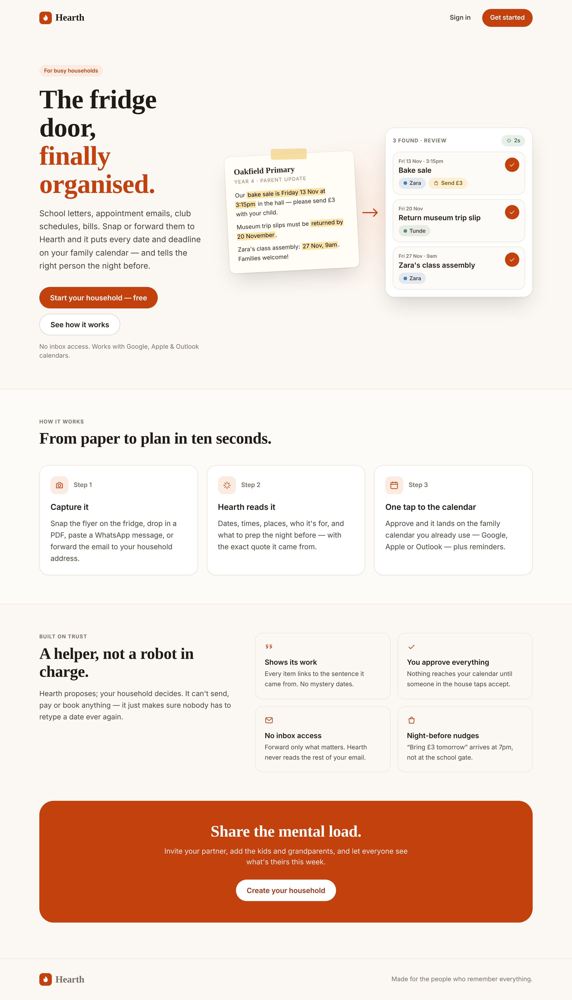
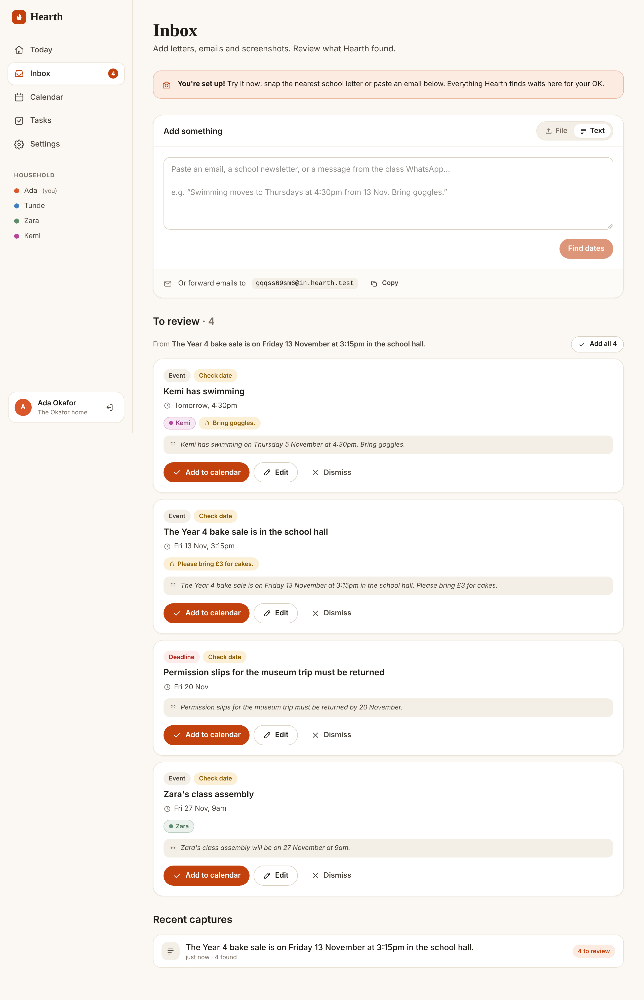
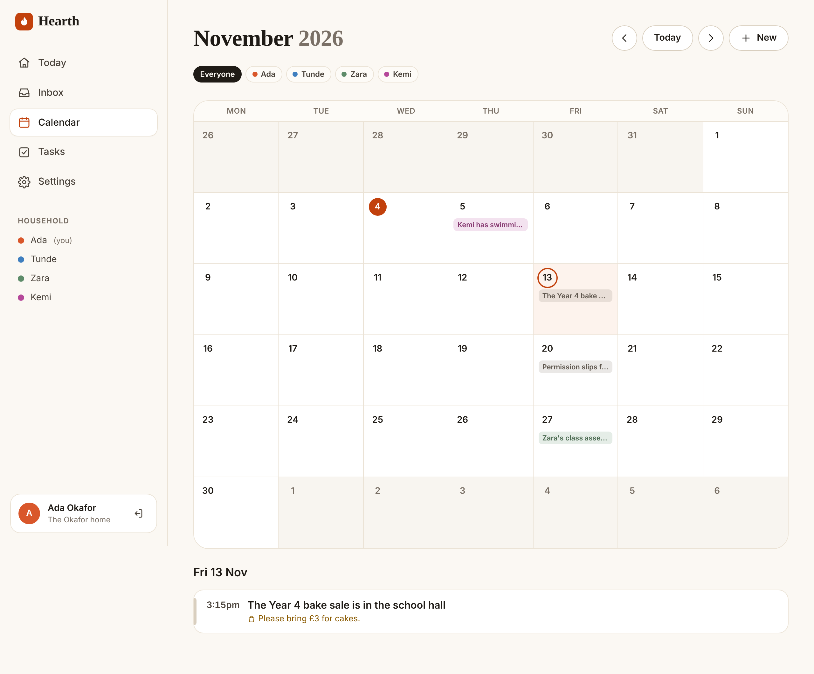

# Hearth — Design System

Hearth should feel like a well-kept kitchen noticeboard: warm, calm, legible at a glance, never busy. The design leans on paper-toned neutrals, a single ember accent for "do this", and **people-as-colours** so a household can scan who something is for without reading.

## Principles

1. **Calm, not busy.** Generous spacing, soft borders, one primary action per surface.
2. **Show your work.** Every extracted item shows the quote it came from (`QuoteIcon` + sunken blockquote).
3. **One-tap trust.** "Add to calendar" is always the most prominent button; edit is one tap away; dismiss is quiet.
4. **People are colours.** A person's colour is used for their chip, calendar pill, avatar and the accent bar on rows.
5. **Mobile-first capture.** Phone photos of paper are the main input, so "Take photo" is the primary action and the tab bar has a raised capture button.

## Tokens

All tokens are CSS custom properties in `src/app/globals.css`, exposed to Tailwind v4 via `@theme inline`, with a full dark-mode set under `prefers-color-scheme: dark`.

| Token | Light | Dark | Use |
|---|---|---|---|
| `--bg` | `#FBF8F3` | `#15120E` | Page background (paper) |
| `--bg-sunken` | `#F4EFE6` | `#100E0B` | Wells, quotes, segmented controls |
| `--surface` | `#FFFFFF` | `#1E1A15` | Cards |
| `--ink` / `--ink-2` / `--muted` | `#1F1B16` / `#4A433B` / `#7A7066` | `#F3EDE4` / `#D5CCBF` / `#A39888` | Text hierarchy |
| `--line` / `--line-strong` | `#EBE3D6` / `#D9CFBF` | `#332C24` / `#4A4136` | Borders |
| `--ember` | `#C2410C` | `#F07A4D` | Primary action, today, brand |
| `--sage` | `#3F6B4B` | `#8FBF9B` | Done / success / tasks |
| `--honey` | `#8A5A00` | `#E2B04A` | Prep needed, "check date" |
| `--danger` | `#B42318` | `#F2877D` | Deadlines, overdue, destructive |

**Person colours** (assigned in order, `src/lib/ids.ts`): ember `#D9572B`, lake `#3F7FBF`, sage `#5E8C6A`, plum `#B5489A`, honey `#C8961E`, teal `#2E9C9C`, iris `#7A5CC2`, clay `#A35D3A`. Tints are derived with `color-mix()` so they work in both themes.

Contrast (WCAG AA, checked): ember on white 5.2:1, ink on paper 16.2:1, muted on paper 4.6:1, honey on its tint 5.2:1, sage on its tint ≥4.5:1, danger on its tint 5.8:1.

## Type

- **Display:** system old-style serif stack (`Iowan Old Style`, Palatino, Georgia), weight 600, used only for page titles and hero copy (`.h-display`).
- **UI:** system sans stack. Body 15–16px; labels 13px semibold; eyebrows 11.5px uppercase, tracked +0.08em.
- No web-font download: fast first paint, and nothing extra to fetch in a Docker build.

## Components

| Component | File | Notes |
|---|---|---|
| Buttons (`.btn-primary/secondary/ghost`, `.btn-sm`) | `globals.css` | Pill-shaped, 40px tall (32px small), 1px press nudge |
| Field (`.field`, `.label`) | `globals.css` | 44px tall, ember focus ring with a soft halo |
| Chip (`.chip`) | `globals.css` | Kind badges, people, prep and confidence flags |
| Card (`.card`) | `globals.css` | 20px radius, hairline border, subtle shadow |
| `CaptureBox` | `components/capture-box.tsx` | File/Text segmented control, camera + file + drag/drop + clipboard paste, forwarding address footer |
| `ReviewCard` | `components/review-card.tsx` | Kind + confidence chips, when/where, people, prep, source quote, Accept / Edit / Dismiss |
| `ItemEditor` | `components/item-editor.tsx` | One form for creating, editing and edit-then-accept |
| `ItemRow` | `components/item-row.tsx` | Agenda row with person accent bar, time column or checkbox, expands inline to edit |
| `PersonChip`, `Avatar`, `PeopleDots` | `components/people.tsx` | Person colours applied consistently |
| `SideNav`, `TabBar` | `components/nav.tsx` | Desktop sidebar with review badge; mobile tab bar with raised capture button |

## Screens

| Screen | Purpose | Screenshot |
|---|---|---|
| Landing | Explain it in 5 seconds: flyer → extracted items | `01-landing.png`, `13-mobile-landing.png` |
| Sign up / Onboarding | Account, then household name, people, timezone | `02-signup.png`, `03-onboarding.png` |
| Inbox | Capture and review; grouped by source; recent captures with status | `04-inbox-review.png`, `10-mobile-inbox.png` |
| Edit item | Edit before accepting | `05-edit-item.png` |
| Today | Greeting, review/overdue banners, "Get ready tonight", next 14 days | `06-today.png`, `11-mobile-today.png`, `14-dark-today.png` |
| Calendar | Monday-first month grid with person-coloured pills (dots on mobile) and a day agenda | `07-calendar.png`, `12-mobile-calendar.png` |
| Tasks | Overdue / This week / Later, with completed items collapsed | `08-tasks.png` |
| Settings | Calendar feeds, forwarding address, people, invites, household, system | `09-settings.png` |

## States

- **Processing:** pulsing "Reading…" chip; the page auto-refreshes every 2s while anything is processing.
- **Low confidence (< 0.8):** honey "Check date" chip.
- **Failed:** danger chip with a Retry action; the error shows on the capture page.
- **Unknown sender:** forwarded mail from outside the household waits as "Unknown sender" until a member taps "Read it".
- **Empty states:** written as friendly sentences with a single next action ("A clear fortnight." → Add something).

## Accessibility

- Visible `:focus-visible` ember outline everywhere; semantic `nav`, `main`, `aria-current` and `aria-label` on icon-only buttons.
- Colour is never the only signal: chips carry names, deadlines say "Due", done items are struck through.
- `prefers-reduced-motion` disables the rise and pulse animations.
- Touch targets are at least 40px; the mobile tab bar respects `safe-area-inset-bottom`.
